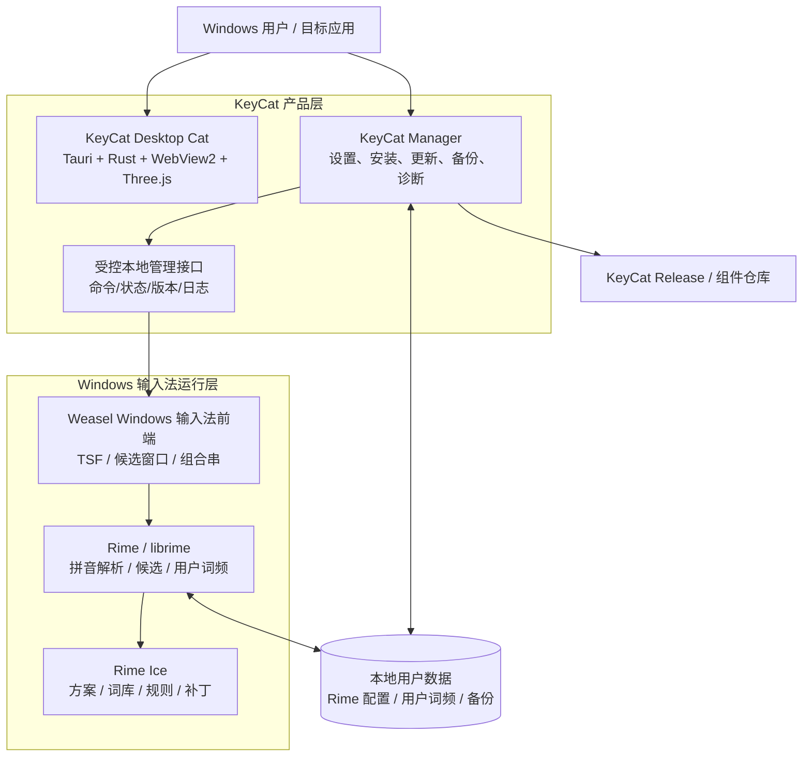
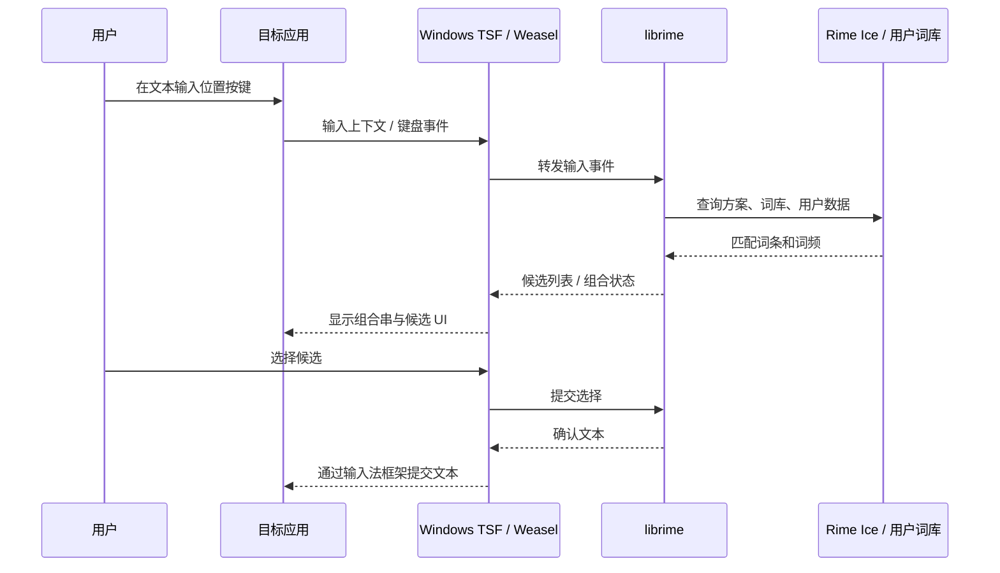
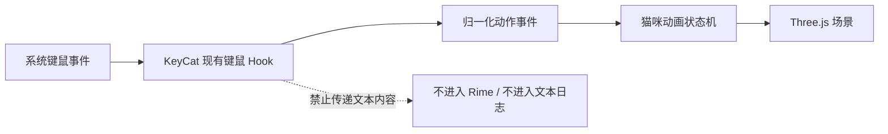
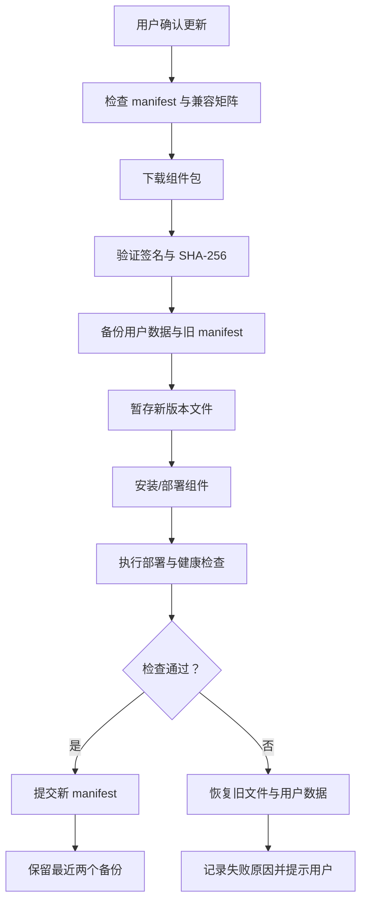
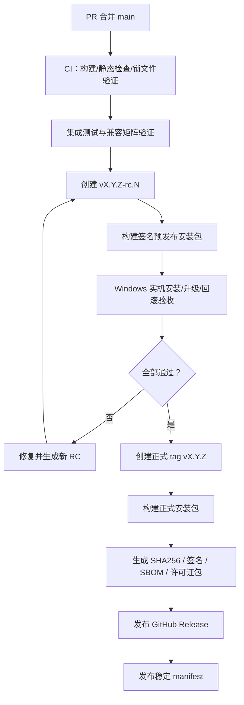

# KeyCat「桌面猫 + 中文输入法」完整技术架构与版本管理方案

- **文档版本**：1.1
- **编制日期**：2026-11-23
- **项目**：KeyCat
- **产品方向**：A — 桌面猫 + 中文拼音输入法
- **首发平台**：Windows
- **文档状态**：技术方案基线（VALIDATING，待 Phase 0 验证）
- **目标仓库**：<https://github.com/zheermao123/KeyCat>

> 本文是开发设计基线，不代表功能已经实现、授权已经取得或 Windows 实机验证已经通过。所有尚未验证的版本、接口、安装参数和兼容性均应在 Phase 0/Phase 1 中确认后锁定。

## 修订记录

| 日期 | 版本 | 变更 | 依据 |
|---|---|---|---|
| 2026-11-23 | 1.0 | 初稿 | — |
| 2026-11-23 | 1.1 | 纳入治理体系为权威架构文档；按已批准决策修订 macOS 路线（D-R01）与双拼范围（D-A06）条款 | DECISIONS.md D-R01、D-A06 |
| 2026-11-24 | 1.2 | 按 T001 Review F-1 在 §13 增加阶段编号权威说明；按 F-6 在 §12 增加测试权威指向 | T001 Review |

---

## 0. 执行摘要

KeyCat 将发展为一款由两个相对独立模块组成的桌面产品：

1. **KeyCat Desktop Cat**：保留现有桌面猫，负责桌面动画、互动、托盘菜单和个性化设置。
2. **KeyCat Input Method**：集成成熟的 Windows Rime 输入法技术栈，负责系统级中文拼音输入。

输入法技术栈：

- **Weasel（小狼毫）**：Windows 输入法前端，负责 Windows 输入法接入、候选窗口和文本组合/提交。
- **Rime / librime**：输入引擎，负责拼音解析、候选生成、词语组合和用户词频。
- **Rime Ice（雾凇拼音）**：Rime 配置、拼音方案、词库和扩展规则。

产品集成原则：

- **统一产品入口，不强行合并进程。**
- **复用上游成熟输入法，不自行重写 TSF 输入法服务。**
- **桌面猫的全局键鼠监听仅服务动画，不处理文本组合和上屏。**
- **输入过程默认完全离线；在线仅用于用户主动触发的更新/下载。**
- **每个组件独立版本化，产品发布时使用经过验证的兼容矩阵。**
- **升级必须备份用户数据，并支持失败恢复。**
- **在确认 KeyCat 上游授权和第三方许可证义务前，不发布对外集成安装包。**

### 0.1 产品范围

| 范围 | 第一阶段决策 |
|---|---|
| 桌面猫 | 保留现有功能与技术实现 |
| 中文输入法 | Windows 首发 |
| 输入方案 | 雾凇拼音全拼为默认方案 |
| 双拼 | 1.0 不纳入验收范围（D-A06）；方案文件随上游保留，后续版本评估开放 |
| 词库 | 雾凇拼音官方词库 + Rime 用户词频/用户词库 |
| 网络 | 输入过程离线；更新联网为可选操作 |
| 云同步 | 第一版不做 |
| macOS | 已移出路线图（D-R01，DEFERRED）；仓库保留 `mac/` 源码快照，不承诺维护与输入法整合 |
| 产品分发 | 一个 KeyCat 安装入口，内部安装/管理独立组件 |

### 0.2 成功标准

- 用户通过一个 KeyCat 安装入口完成桌面猫和输入法安装。
- Windows 输入法列表中可以启用 KeyCat 所集成的 Weasel/Rime 输入法。
- 在记事本、浏览器、Office 等常见程序中完成中文输入、候选选择和上屏。
- 断网后仍能正常输入中文。
- 关闭或崩溃桌面猫，不影响输入法。
- 更新 KeyCat 桌面猫，不会无必要地重装/重置输入法。
- 更新 Weasel 或 Rime Ice，不丢失用户词频和自定义配置。
- 卸载时允许用户选择保留或删除个人输入数据。
- 发布物包含完整第三方声明、许可证和符合适用许可证的源代码提供方式。

---

## 1. 现有仓库基线与改造约束

本节根据当前仓库公开内容和已检查文件形成；实施前应再次以目标分支的实际提交为准。

### 1.1 当前已知情况

| 项目 | 当前观察 |
|---|---|
| 仓库 | `zheermao123/KeyCat` |
| 默认分支 | `main` |
| 当前 README 产品版本描述 | 复制时记录上游 `v1.0.4` |
| `win/package.json` | `version` 为 `1.0.4` |
| Windows 外壳 | Tauri 2 + Rust，前端由 WebView2 绘制 |
| Windows 构建 | Node.js 22+、Rust；`npm ci`、`npm run dist` |
| macOS 外壳 | Swift 原生壳 |
| 共用动画 | `web/`，Three.js |
| Windows 标识符 | `com.ellobok.keycat` |
| Windows 更新地址 | 当前 `tauri.conf.json` 指向上游 `ElloboDK/KeyCat` 的 `latest.json` |
| 当前 README | 声明仓库是上游副本，原项目权利归原作者 |
| 输入法代码快照 | README 当前列出 `weasel/`、`rime-ice/` 两个 subtree 快照 |
| 当前发布方式 | macOS 与 Windows 共用 GitHub Release；Windows Actions 补传产物 |

### 1.2 必须先处理的现有问题

1. **上游授权未确认**：README 声明仅供个人学习/备份，并声明原项目代码、文档和设计权利归原作者。没有确认修改、再分发、重新品牌化和商业分发权限前，不得把当前 KeyCat 桌面猫代码作为可自由分发的产品基础。
2. **更新地址仍指向上游**：必须在正式分发前迁移到 KeyCat 自己控制的更新源，或明确继续跟随上游的策略。不得让衍生产品意外接收上游更新。
3. **应用标识需确认**：Windows 当前标识 `com.ellobok.keycat`，macOS 当前清单中使用另一标识。应制定 KeyCat 自有标识策略，并评估用户数据目录和旧版升级迁移。
4. **版本号当前分散**：Windows `package.json`、macOS `Info.plist`、Release tag 和更新清单必须统一映射，避免人工漏改。
5. **第三方 subtree 快照不等于自动集成**：仓库包含 Weasel/Rime Ice 源码快照，不代表已完成构建、运行时集成、兼容验证或安装器整合。
6. **全局键鼠监听需隔离**：桌面猫监听逻辑不能接管输入法文本输入链路。
7. **发布签名密钥需独立管理**：更新私钥不可进入 Git 历史；需要离线备份、访问控制和密钥轮换/灾备方案。

### 1.3 不在本项目第一版范围内

- 自研拼音解析算法。
- 自研 Windows TSF Text Service。
- 云端输入、云端词库同步。
- 输入历史记录、按键内容遥测。
- Android、iOS、Linux 输入法。
- 第一版即深度修改 Weasel 上游核心。
- 第一版即将所有第三方组件源码编译进 KeyCat 单一可执行文件。

---

## 2. 总体系统架构

### 2.1 逻辑架构



### 2.2 物理进程架构

建议至少保留以下运行边界：

| 进程/组件 | 生命周期 | 权限 | 职责 |
|---|---|---|---|
| `KeyCat.exe` | 用户启动桌面猫时运行 | 默认普通用户权限 | 桌面猫窗口、托盘、动画和交互 |
| Weasel 输入法进程/组件 | 由 Windows 输入法框架和 Weasel 管理 | 按 Weasel 官方设计 | TSF 输入服务、候选窗口和输入上下文 |
| `KeyCat Manager` 功能模块 | 可作为 KeyCat 内部管理模块，必要时独立辅助进程 | 普通用户；安装阶段按需提权 | 安装/卸载、状态检查、备份、配置部署 |
| 安装器/更新器 | 安装或更新时短暂运行 | 最小必要权限 | 文件部署、注册、签名校验、回滚 |

**不建议第一版额外创建长期驻留的 KeyCat 输入法后台守护进程。** 优先使用 Weasel 自身生命周期和 Windows 输入法框架。只有当后续出现无法由 Weasel/安装器解决的管理需求时，才评估独立服务；服务必须有明确 IPC、权限边界和退出策略。

### 2.3 输入事件链路



KeyCat 桌面猫的键盘监听是另一条独立链路：



必须明确：桌面猫动作通道不得模拟 TSF 组合串，不得截获候选按键，不得保存实际输入文本。应确认 Windows 输入法服务的键盘事件优先级与桌面猫 Hook 共存，不得因 Hook 处理不当吞键或改变目标应用行为。

---

## 3. 模块设计与职责

### 3.1 KeyCat Desktop Cat

**保留内容：**

- Tauri/Rust 应用壳。
- Three.js 猫咪、键盘和动画。
- 托盘菜单、窗口置顶、鼠标穿透和拖动。
- 猫咪行为参数与用户设置。
- 桌面猫所需的键鼠动作监听。

**改造内容：**

- 将键鼠监听与输入法管理逻辑分层。
- 桌面猫设置中增加“输入法”入口，但不直接承担输入法运行。
- 增加输入法组件状态展示（已安装/未安装/需修复/版本）。
- 不在桌面猫启动时强制重启输入法。
- 桌面猫崩溃、退出或升级，不影响 Weasel。

### 3.2 KeyCat Manager

管理器可先作为现有 Tauri/Rust 应用中的独立模块实现，避免第一版增加新的 UI 运行时。

职责：

- 检测 Weasel 安装状态、版本和路径。
- 检查 Rime 用户目录和配置文件。
- 安装或修复已锁定的 Weasel 组件。
- 部署指定版本的 Rime Ice 文件。
- 备份、恢复和重置用户配置。
- 展示输入法版本、配置版本、部署状态。
- 执行更新前检查和更新后验证。
- 记录脱敏的安装/更新诊断日志。

**管理器不负责：**

- 直接实现 TSF。
- 自行生成候选词。
- 将键盘输入文本发给 KeyCat UI。
- 在后台上传用户输入或词库。
- 未经确认删除用户数据。

### 3.3 Weasel

第一阶段优先采用 Weasel 官方发布版本及其官方安装/配置机制。

建议策略：

- 不直接 fork 和修改 Weasel 核心，除非官方版本确实无法满足明确需求。
- 如果只需品牌区分，优先研究官方支持的方案命名、配置和皮肤能力。
- 如果要重命名输入法显示名称、修改候选 UI 或安装器，先评估是否需要维护 fork，以及 GPLv3 对修改和分发的要求。
- 不要只把 `Weasel.dll` 或某个 EXE 复制进 KeyCat 安装目录；应遵守官方安装器注册流程。
- 安装器应验证目标版本、签名、架构和安装结果。

### 3.4 Rime / librime

职责：

- 拼音解析。
- 候选生成与排序。
- 方案状态管理。
- 用户词频/用户词库。
- 部署配置与数据文件。

第一版不直接修改引擎核心。只有性能、兼容或功能需求经测试确认无法通过现有配置解决时，才考虑 fork。

### 3.5 Rime Ice

职责：

- 提供默认全拼方案。
- 提供词库和扩展规则。
- 提供常见双拼方案（方案文件随上游保留；1.0 不纳入验收，见 D-A06）。
- 通过用户补丁实现 KeyCat 默认偏好。

配置原则：

- 上游文件视为只读的受管依赖。
- KeyCat 自定义配置放在独立补丁文件中。
- 用户自定义配置放在单独文件或用户目录。
- 不直接覆盖用户词频数据库。
- 更新前先备份；更新后执行 Rime 部署和配置检查。

Rime Ice 的上游安装说明对全量覆盖用户目录有明确提示；KeyCat 应避免在升级时无差别清空用户目录。应采用“受管文件清单 + 用户补丁 + 用户数据分离”的方式管理。

---

## 4. 代码仓库与目录结构

### 4.1 建议目标目录

以下为目标结构建议，不要求一次性迁移所有现有文件：

```text
KeyCat/
├── .github/
│   └── workflows/
│       ├── ci-windows.yml
│       ├── input-stack-verify.yml
│       ├── release-windows.yml
│       ├── release-manifest.yml
│       └── pages.yml
│   （macOS CI/Release 工作流已随 D-R01 移出路线图）
│
├── docs/
│   ├── architecture/
│   │   ├── SYSTEM-ARCHITECTURE.md
│   │   ├── WINDOWS-IME-INTEGRATION.md
│   │   └── SECURITY-PRIVACY.md
│   ├── input-method/
│   │   ├── ARCHITECTURE.md
│   │   ├── COMPONENT-MATRIX.md
│   │   ├── VERSIONING.md
│   │   ├── INSTALL-UNINSTALL.md
│   │   ├── DATA-MIGRATION.md
│   │   ├── LICENSES.md
│   │   └── ACCEPTANCE.md
│   └── releases/
│
├── input-stack/
│   ├── input-stack.lock.yaml
│   ├── manifest.schema.json
│   ├── weasel/
│   │   ├── patches/
│   │   └── packaging/
│   ├── rime-ice/
│   │   ├── patches/
│   │   └── packaging/
│   ├── rime/
│   │   └── compatibility/
│   └── licenses/
│
├── win/
│   ├── src/
│   │   ├── cat/
│   │   ├── input_method/
│   │   │   ├── mod.rs
│   │   │   ├── detection.rs
│   │   │   ├── installer.rs
│   │   │   ├── config.rs
│   │   │   ├── deploy.rs
│   │   │   ├── backup.rs
│   │   │   ├── update.rs
│   │   │   └── diagnostics.rs
│   │   └── ...
│   ├── packaging/
│   │   ├── nsis/
│   │   └── scripts/
│   └── ...
│
├── mac/
├── web/
├── site/
└── tools/
```

### 4.2 对当前 subtree 的处理建议

当前 README 已列出 `weasel/` 与 `rime-ice/` subtree 源码快照。建议 Phase 0 做一次仓库核查，并在以下策略中选定一种：

**策略 A（推荐第一版）：源码快照留档，发布使用上游官方二进制/配置包**

- 保留 subtree 作为审查、补丁和许可证追踪依据。
- 构建和发布时下载经过锁定的官方发行文件。
- 对下载文件做 SHA-256 校验，并验证上游签名（如果上游提供）。
- 不在 KeyCat 主构建中重编译整个 Weasel。
- 优点：降低构建复杂度和维护成本。
- 风险：必须有可靠的供应链校验和上游发布物获取策略。

**策略 B：从锁定源码构建**

- 使用固定 tag/commit 构建 Weasel。
- 固定其 submodules、工具链和依赖。
- 输出构建证明、许可证包和源代码对应关系。
- 优点：构建可复现、便于自定义。
- 风险：Windows C++/ATL/MFC、Boost、CMake、NSIS 等构建链更复杂，长期维护成本高。

第一版采用 A；如果未来确实要修改 Weasel 核心，再迁移到 B。

---

## 5. 管理接口与配置契约

### 5.1 Rust 管理模块边界

建议在 Rust 内部定义清晰的服务接口，UI 只调用受控命令，不直接访问注册表或系统目录。

概念接口：

```rust
pub struct InputMethodStatus {
    pub installed: bool,
    pub weasel_version: Option<String>,
    pub rime_engine_version: Option<String>,
    pub rime_ice_version: Option<String>,
    pub deployment_status: DeploymentStatus,
    pub needs_restart_or_redeploy: bool,
}

pub enum DeploymentStatus {
    Ready,
    NotInstalled,
    NeedsDeploy,
    NeedsRepair,
    Unknown,
}

pub trait InputMethodManager {
    fn detect(&self) -> Result<InputMethodStatus>;
    fn install(&self, version: &InputStackVersion) -> Result<InstallReport>;
    fn repair(&self) -> Result<RepairReport>;
    fn backup(&self) -> Result<BackupReport>;
    fn restore(&self, backup_id: &str) -> Result<RestoreReport>;
    fn deploy_config(&self) -> Result<DeployReport>;
    fn uninstall(&self, policy: UserDataPolicy) -> Result<UninstallReport>;
}
```

以上是设计接口，不是现有代码。实现时应使用项目现有错误类型、异步约定和 Tauri command 规范。

### 5.2 UI 命令建议

| 命令 | 用途 | 是否需要管理员权限 |
|---|---|---|
| `ime_get_status` | 查询安装和版本状态 | 否 |
| `ime_check_compatibility` | 检查依赖矩阵 | 否 |
| `ime_backup_user_data` | 备份配置与词库 | 否 |
| `ime_restore_user_data` | 恢复备份 | 通常否 |
| `ime_deploy_config` | 执行 Rime 部署 | 按目录权限决定 |
| `ime_install_component` | 安装 Weasel | 由安装器按需提权 |
| `ime_repair_component` | 修复输入法 | 由安装器按需提权 |
| `ime_update_component` | 更新指定组件 | 由安装器按需提权 |
| `ime_uninstall_component` | 卸载 Weasel | 由安装器按需提权 |
| `ime_open_user_folder` | 打开用户配置目录 | 否 |

### 5.3 进程调用安全

- 使用固定可执行文件路径，不通过 shell 拼接不可信参数。
- 对路径进行规范化，防止目录穿越。
- 不从远端 manifest 直接执行任意命令。
- 只允许调用 manifest 中预定义的安装动作。
- 下载后先校验 SHA-256 和签名，再执行。
- 日志不得包含实际输入文本、组合串、候选内容或用户词条。
- 管理器不应常驻管理员权限。
- 提权只发生在确实需要写入系统位置或注册组件时。

---

## 6. 数据目录、配置与迁移

### 6.1 数据分层

必须区分四类数据：

| 数据类别 | 例子 | 更新策略 |
|---|---|---|
| 产品程序 | KeyCat.exe、Weasel 程序文件 | 由安装器/更新器管理 |
| 上游配置 | Rime Ice schema、词库、OpenCC 文件 | 由组件版本管理器管理 |
| KeyCat 补丁 | 默认方案、主题、KeyCat 默认快捷键 | 随 KeyCat 配置包版本管理 |
| 用户数据 | 用户词频、用户词库、自定义补丁、偏好 | 用户所有，升级不得覆盖 |

### 6.2 建议数据布局

具体路径必须以所锁定 Weasel 版本实际使用的路径为准。以下是逻辑分层示意，不应未经验证就硬编码：

```text
%APPDATA%\Rime\
├── upstream/                 # 可选：受管上游文件
├── keycat/                   # KeyCat 管理的默认补丁/配置
├── user/                     # 用户自定义配置（如方案支持）
├── userdb/                   # Rime 用户词频数据库
└── backups/
    └── YYYYMMDD-HHMMSS/
```

如果 Weasel 的真实目录约定不允许直接使用以上子目录，应采用独立 manifest 记录文件所有权和哈希，而不是改变 Rime 约定目录。

### 6.3 配置优先级

建议采用如下逻辑优先级：

1. Rime/Weasel 官方默认配置。
2. KeyCat 锁定版本的 Rime Ice 文件。
3. KeyCat 自带补丁（只覆盖明确指定的选项）。
4. 用户自定义补丁（优先级最高）。
5. 用户词频/用户词库由 Rime 自身维护。

不得在每次更新时把用户目录清空后重新复制完整配置包。

### 6.4 备份范围

至少备份：

- 用户自定义 YAML 和方案文件。
- 用户词频数据库（`*.userdb` 等实际文件）。
- 用户自定义词库。
- KeyCat 自定义设置。
- 当前组件版本 manifest。

备份文件应：

- 保存在用户本地目录。
- 带有时间戳、数据格式版本和组件版本信息。
- 可校验完整性。
- 不上传云端。
- 恢复前先备份当前状态，支持再次回退。

### 6.5 数据迁移

升级前执行：

1. 读取旧版本 manifest。
2. 备份用户目录。
3. 检查磁盘空间。
4. 检查目标组件兼容性。
5. 执行配置迁移脚本（如需要）。
6. 验证 YAML/词库文件。
7. 执行 Rime 部署。
8. 验证输入法可以启动。
9. 成功后提交新 manifest；失败则恢复备份。

配置格式迁移必须有单独的 `user_data_schema_version`，不能用 KeyCat 产品版本代替。

---

## 7. 安装、升级、修复和卸载

### 7.1 安装策略

目标是“一个 KeyCat 安装入口”，不是把所有组件揉成一个进程或一个二进制。

建议安装顺序：

1. 检查 Windows 版本、CPU 架构、WebView2 和磁盘空间。
2. 检查现有 KeyCat/Weasel/Rime 安装。
3. 展示组件版本、许可声明和安装选项。
4. 安装 KeyCat Desktop Cat。
5. 安装锁定版本的 Weasel（使用官方安装/注册流程）。
6. 部署 Rime Ice 受管配置和 KeyCat 补丁。
7. 执行 Rime 部署。
8. 验证 Weasel 注册、配置和输入法状态。
9. 生成安装 manifest。
10. 提示用户如何在 Windows 输入法切换菜单中启用输入法。

第一版建议允许用户选择：
- 安装桌面猫 + 输入法（默认）。
- 仅安装桌面猫。
- 仅安装/修复输入法（高级维护入口）。

### 7.2 安装器职责

安装器负责：

- 依赖检测。
- 组件包校验。
- 正确调用 Weasel 安装器。
- 部署受管配置。
- 创建组件 manifest。
- 记录安装日志。
- 在失败时清理本次未完成操作或恢复备份。

Tauri NSIS installer hooks 可用于把文件或自定义步骤纳入安装流程，但不应假定它能替代 Weasel 的系统注册步骤。具体宏和执行时机必须通过最小原型验证。

### 7.3 更新分级

组件更新分成三个独立通道：

| 更新通道 | 内容 | 默认策略 |
|---|---|---|
| KeyCat 产品更新 | 桌面猫、管理器、安装器 | 用户确认后更新；稳定后可提供自动检查 |
| Input Stack 更新 | Weasel、Rime/librime | 只升级到已验证兼容矩阵 |
| Rime Ice 配置更新 | schema、词库、补丁 | 先备份，再部署；保留用户补丁 |

不允许输入法更新仅因为 KeyCat 桌面猫升级就被强制执行。

### 7.4 更新事务



更新事务应尽可能做到原子化。对于无法原子替换的 Weasel 安装步骤，必须在更新前记录旧版本安装状态，并提供明确修复/回退流程。

### 7.5 卸载策略

卸载界面必须区分：

- 卸载 KeyCat 桌面猫。
- 卸载 Weasel 输入法组件。
- 删除 KeyCat 管理的 Rime Ice 文件。
- 保留用户配置、用户词频和自定义词库。
- 永久删除个人输入数据。

默认建议：**卸载程序时保留用户输入数据**，并由用户明确选择是否删除。不得默认删除整个 Rime 用户目录，因为该目录可能被其他 Rime 前端或方案共用。

---

## 8. 完整版本管理方案

本节是项目长期维护的核心。必须避免“一个版本号代表所有组件”的做法。

### 8.1 版本维度

KeyCat 至少维护以下独立版本：

| 版本字段 | 示例格式 | 管理对象 | 是否随产品版本递增 |
|---|---|---|---|
| `product_version` | `1.2.0` | KeyCat 产品 | 是 |
| `desktop_cat_version` | `1.2.0` | 桌面猫模块 | 通常跟随产品 |
| `manager_version` | `1.2.0` | 管理器 | 通常跟随产品 |
| `weasel_version` | 上游版本原样 | Weasel | 否 |
| `rime_version` | 上游版本/commit | librime/引擎 | 否 |
| `rime_ice_version` | 上游 tag/commit | 雾凇拼音配置 | 否 |
| `keycat_ime_config_version` | `1.0.0` | KeyCat 自定义补丁包 | 独立 |
| `user_data_schema_version` | 整数，如 `1` | 用户数据格式 | 仅迁移时递增 |
| `installer_version` | 与产品版本映射 | 安装器 | 通常跟随产品 |
| `release_manifest_version` | 整数，如 `1` | 更新清单格式 | 清单结构变化时递增 |

### 8.2 KeyCat 产品版本规则

采用 Semantic Versioning（SemVer）：

`MAJOR.MINOR.PATCH`

- **MAJOR**：不兼容的产品行为、配置格式、安装结构或重大数据迁移。
- **MINOR**：向后兼容的新功能，例如增加输入法管理功能或新的设置入口。
- **PATCH**：向后兼容的 bug 修复、安全修复和小范围体验修正。

示例：

| 版本 | 含义 |
|---|---|
| `1.0.4` | 当前仓库 README/Windows package 中观察到的版本基线 |
| `1.1.0` | 加入输入法管理页，但不改变用户数据格式 |
| `1.1.1` | 修复安装状态识别 bug |
| `1.2.0` | 增加词库备份和恢复 |
| `2.0.0` | 需要不兼容迁移或重大安装架构变化 |

开发版本可使用：
- `1.1.0-alpha.1`
- `1.1.0-beta.1`
- `1.1.0-rc.1`

正式 Release 不使用 `latest` 作为唯一版本标识；必须保留不可变的版本 tag 和资产校验值。

### 8.3 第三方组件版本规则

第三方版本**不改写为 KeyCat 版本**。例如：

- Weasel 使用上游 Release tag/version。
- librime 使用上游 tag/version，必要时同时记录 commit SHA。
- Rime Ice 使用上游 tag 或 commit SHA。
- 如果上游没有正式 tag，必须锁定完整 commit SHA。

每个组件必须记录：

- 上游仓库 URL。
- tag/version。
- commit SHA。
- 下载 URL。
- 文件 SHA-256。
- 许可证 SPDX 标识。
- 是否有本地 patch。
- patch 文件及其 SHA-256。
- 兼容性验证记录。
- 供应链来源和校验结果。

不得仅使用 `latest` 下载地址进行可复现构建。构建时必须使用明确版本和校验值。

### 8.4 兼容矩阵

新增 `input-stack/input-stack.lock.yaml`，作为 CI 和安装器共同读取的唯一组件锁定来源。

示例（版本号为占位符，不能直接用于发布）：

```yaml
schema_version: 1

product:
  name: KeyCat
  version: "1.1.0"

platform:
  os: windows
  architectures:
    - x86_64
  minimum_supported:
    - "Windows 11"
  compatibility_tested:
    - "Windows 11 x64"

components:
  weasel:
    repository: "https://github.com/rime/weasel"
    version: "REPLACE_WITH_VERIFIED_RELEASE"
    commit: "REPLACE_WITH_FULL_COMMIT_SHA"
    artifact:
      url: "REPLACE_WITH_PINNED_ASSET_URL"
      sha256: "REPLACE_WITH_SHA256"
    license: "GPL-3.0"
    install_method: "official-installer"
    required: true

  librime:
    repository: "https://github.com/rime/librime"
    version: "REPLACE_WITH_VERIFIED_RELEASE"
    commit: "REPLACE_WITH_FULL_COMMIT_SHA"
    license: "BSD-3-Clause"
    required: true

  rime_ice:
    repository: "https://github.com/iDvel/rime-ice"
    version: "REPLACE_WITH_VERIFIED_TAG_OR_COMMIT"
    commit: "REPLACE_WITH_FULL_COMMIT_SHA"
    artifact:
      url: "REPLACE_WITH_PINNED_ASSET_URL"
      sha256: "REPLACE_WITH_SHA256"
    license: "GPL-3.0"
    required: true

keycat_config:
  version: "1.0.0"
  patch_directory: "input-stack/rime-ice/patches"

user_data:
  schema_version: 1

release:
  manifest_schema_version: 1
```

锁文件更新必须通过 PR，不允许 CI 自动追随上游最新版本后直接发布。

### 8.5 组件兼容矩阵

维护 `docs/input-method/COMPONENT-MATRIX.md`，每个可发布版本记录：

| KeyCat 产品版本 | Windows | Weasel | librime | Rime Ice | KeyCat 补丁 | 测试结果 |
|---|---|---|---|---|---|---|
| `1.1.0` | Win 11 x64 | 锁定版本 | 锁定版本 | 锁定版本 | `1.0.0` | 待验证 |
| `1.1.1` | Win 11 x64 | 同上 | 同上 | 同上 | `1.0.0` | 待验证 |

规则：

1. 一个 KeyCat 正式版本必须对应唯一且可复现的输入栈组合。
2. 未进入兼容矩阵的组件版本不得进入正式安装包。
3. 只升级 Rime Ice 时也必须执行部署、词库和用户数据回归测试。
4. Weasel 或 librime 升级必须执行 Windows 输入法兼容性测试。
5. 若组件更新不影响产品代码，也应发布新的组件 manifest/release note。
6. 任何组件升级都不能自动改变用户数据 schema。

### 8.6 发布清单格式

每个 KeyCat Release 附带 `keycat-release-manifest.json`，描述产品和组件版本。

示例：

```json
{
  "manifest_schema_version": 1,
  "product": {
    "name": "KeyCat",
    "version": "1.1.0",
    "channel": "stable"
  },
  "platform": {
    "os": "windows",
    "architecture": "x86_64"
  },
  "components": {
    "desktop_cat": {
      "version": "1.1.0"
    },
    "manager": {
      "version": "1.1.0"
    },
    "weasel": {
      "version": "PINNED_UPSTREAM_VERSION",
      "commit": "FULL_COMMIT_SHA"
    },
    "librime": {
      "version": "PINNED_UPSTREAM_VERSION",
      "commit": "FULL_COMMIT_SHA"
    },
    "rime_ice": {
      "version": "PINNED_UPSTREAM_VERSION",
      "commit": "FULL_COMMIT_SHA"
    },
    "keycat_ime_config": {
      "version": "1.0.0"
    }
  },
  "user_data_schema_version": 1,
  "artifacts": [
    {
      "name": "KeyCat-Windows-Setup.exe",
      "sha256": "GENERATED_AT_BUILD"
    }
  ]
}
```

实际 Release 必须把占位符替换成真实版本、SHA 和资产地址。manifest 本身也应有版本控制和完整性校验。

### 8.7 版本来源与单一事实源

建议将以下文件作为版本事实来源：

| 文件 | 内容 |
|---|---|
| `win/package.json` | KeyCat Windows 产品版本 |
| `mac/Info.plist` | macOS 桌面猫版本（与产品策略映射） |
| `input-stack/input-stack.lock.yaml` | 第三方输入组件版本锁 |
| `input-stack/manifest.schema.json` | 输入栈锁文件 schema |
| `docs/input-method/COMPONENT-MATRIX.md` | 已验证兼容矩阵 |
| Git tag `vX.Y.Z` | 正式产品版本不可变标识 |
| Release manifest | 本次实际发布资产和组件组合 |

避免手工在多个文件重复填写版本。建议 CI 从产品版本源生成其他构建元数据，并检查 Windows/macOS 版本是否符合发布策略。

### 8.8 分支与标签策略

建议分支：

| 分支 | 用途 |
|---|---|
| `main` | 可发布主线，始终保持 CI 通过 |
| `feature/ime-phase-N-*` | 阶段功能开发 |
| `fix/*` | 缺陷修复 |
| `release/X.Y` | 仅在需要维护旧稳定版本时建立 |
| `hotfix/*` | 生产紧急修复 |

建议流程：

1. 功能分支从 `main` 创建。
2. PR 必须通过 Windows 构建、静态检查、配置校验和许可证检查。
3. 合并后进入集成测试。
4. 发布候选版本使用 `vX.Y.Z-rc.N`。
5. RC 完成实机验收后打正式 tag `vX.Y.Z`。
6. 正式 tag 对应的源码和资产不可移动或覆盖。
7. 发布后若修复，递增 PATCH 版本并发布新 tag，不重写旧 Release。

建议提交信息采用 Conventional Commits：

- `feat(ime): add input method status panel`
- `feat(installer): add weasel deployment`
- `fix(rime): preserve user patches on update`
- `build(release): pin input stack versions`
- `docs(architecture): define process boundaries`

### 8.9 组件升级策略

**Weasel 升级：**

- 检查上游 Release 和安全/兼容变更。
- 先在独立测试分支升级锁文件。
- 执行安装、注册、候选窗口、输入提交和卸载测试。
- 确认与锁定 librime 的兼容性。
- 更新许可证和源代码对应信息。
- 通过兼容矩阵后才能进入稳定通道。

**librime 升级：**

- 检查 Weasel 的依赖版本和 ABI 兼容性。
- 测试配置解析、词库加载、部署、用户数据库迁移。
- 不允许只升级 librime 而跳过 Weasel 联合测试。

**Rime Ice 升级：**

- 先比较上游文件差异。
- 检查 schema、词库、OpenCC 和扩展依赖变化。
- 只更新受管文件。
- 保留 KeyCat 补丁和用户补丁。
- 执行 YAML 校验和 Rime 部署。
- 对用户词频数据库做升级前后完整性检查。

**安全紧急更新：**

- 对影响安全或输入法稳定性的更新建立 hotfix。
- 先在预发布通道验证。
- 需要时单独发布组件修复包，不必强制升级桌面猫。
- 保留上一稳定组件组合以便回滚。

### 8.10 版本生命周期

建议稳定通道采用：

- `stable`：普通用户默认通道。
- `preview`：RC/Beta 测试通道。
- `nightly`：仅开发验证，不承诺兼容性。

每个通道都必须指向明确 manifest；不能让 stable 指向未经测试的上游 `latest`。

---

## 9. CI/CD 与发布工程

### 9.1 CI 检查

每个 PR 至少执行：

1. Rust 格式和静态检查。
2. Tauri/前端构建检查。
3. Windows 编译。
4. 输入栈锁文件 schema 校验。
5. 组件下载地址和 SHA-256 检查。
6. Rime YAML/配置文件静态校验。
7. 许可证清单完整性检查。
8. 安装脚本静态检查。
9. 用户数据迁移测试。
10. 依赖变更报告。

### 9.2 集成测试环境

至少准备：

- 干净 Windows 11 x64 虚拟机。
- 已安装旧版 KeyCat 的升级环境。
- 已安装独立 Weasel 的环境。
- 已有 Rime 用户数据的环境。
- 普通用户权限环境。
- 需要 UAC 的安装/修复环境。

如果产品继续支持 Windows 10，应建立独立测试矩阵并明确其支持边界，不能仅因旧 README 写了 Windows 10 就宣称当前版本兼容。

### 9.3 发布工作流



### 9.4 Release 资产

建议每次 Windows 正式 Release 至少提供：

- `KeyCat-Windows-Setup.exe`
- `KeyCat-Windows-Setup.exe.sig`（如果由所选更新机制生成）
- `keycat-release-manifest.json`
- `SHA256SUMS.txt`
- `THIRD-PARTY-NOTICES.md`
- 对应许可证文件。
- GPL 组件适用的完整对应源代码或合规的源代码获取方式。
- Release Notes。
- SBOM（建议 SPDX 或 CycloneDX 格式）。

### 9.5 签名与密钥

必须区分：

1. **安装程序代码签名证书**：用于 Windows SmartScreen/发布者身份和文件签名。
2. **Tauri updater 签名密钥**：用于更新包完整性验证。
3. **上游组件签名**：如果 Weasel 等上游发布物提供签名，则验证上游签名。
4. **哈希校验**：对每个下载资产核对锁文件中的 SHA-256。

私钥要求：

- 只存放在受限 GitHub Actions Secrets 或安全密钥库。
- 不得提交到仓库或普通构建日志。
- 建立离线加密备份和双人恢复流程。
- 公钥可放在应用配置中。
- 私钥轮换必须设计兼容过渡期。
- 密钥丢失会影响已安装客户端的更新能力，必须在上线前完成灾备演练。

### 9.6 更新源迁移

当前 Windows updater endpoint 指向上游仓库。产品正式发布前必须迁移到 KeyCat 自有 Release/更新服务。

迁移步骤：

1. 确认产品自有应用 identifier。
2. 生成 KeyCat 自己的 updater 密钥对。
3. 将公钥写入产品配置。
4. 将私钥存入 CI Secret，并离线备份。
5. 建立 KeyCat 自有 Release 资产结构。
6. 验证新旧版本升级路径。
7. 确认不再从上游 KeyCat endpoint 获取更新。
8. 验证错误 manifest、错误签名和网络失败时的安全行为。

Tauri updater 要求更新包签名验证；私钥不可泄露，丢失会影响后续向既有安装用户发布更新。详见 Tauri 官方 updater 文档。

---

## 10. 安全、隐私与供应链

### 10.1 隐私原则

| 数据 | 是否收集 | 处理方式 |
|---|---|---|
| 桌面猫动作所需按键标识 | 是 | 仅内存事件，驱动动画 |
| 实际输入文本 | 否 | 不采集、不记录 |
| 输入组合串 | 否 | 不传给 KeyCat 管理器 |
| 候选词内容 | 否 | 不传给桌面猫或网络服务 |
| 用户词频/词库 | 是 | Rime 本地维护 |
| 用户自定义配置 | 是 | 本地保存 |
| 崩溃日志 | 可选 | 只保留组件状态/错误码，不包含输入文本 |

### 10.2 安全边界

- KeyCat Manager 默认普通用户权限。
- 只有安装/注册/卸载需要时才请求 UAC。
- 不长期以管理员权限运行桌面猫。
- 不把输入法用户目录暴露给 WebView 任意文件访问。
- 所有安装包校验成功后才执行。
- 禁止远端配置下发任意 shell 命令。
- 不将用户目录内容作为遥测上传。
- 诊断包必须经过脱敏，并允许用户预览后导出。

### 10.3 供应链

- 所有第三方版本固定 tag/commit。
- 下载文件记录 SHA-256。
- 尽可能验证上游签名。
- 每次升级生成依赖差异报告。
- 维护 SBOM。
- 记录许可证及版权声明。
- 依赖来源变化必须经过 PR 审查。
- 对 GPL 组件的修改和分发建立源代码对应关系。

---

## 11. 许可证与知识产权门禁

这是对外发布的阻断性门禁。

### 11.1 已知第三方许可证线索

| 项目 | 当前可查许可证线索 | 发布要求 |
|---|---|---|
| Weasel | GPL-3.0 | 分发时遵守 GPLv3，提供适用源代码和声明 |
| Rime Ice | GPL-3.0 | 分发配置/词库时遵守对应许可证要求 |
| librime | BSD-3-Clause | 保留版权、许可和免责声明 |
| Tauri | MIT / Apache-2.0（依具体组件） | 随发行物保留适用声明 |
| Three.js | MIT | 保留许可声明 |

必须以实际锁定版本中的 LICENSE 文件和依赖清单为准，不以本表代替法律审查。

### 11.2 KeyCat 上游授权

当前仓库 README 声明它是 ElloboDK/KeyCat 的副本，原项目权利归原作者，并称仅供个人学习和备份用途。该声明不足以证明 KeyCat 有权重新品牌化并公开分发。

在发布集成产品前，必须取得并归档：

- 原项目许可证或明确书面授权。
- 允许修改和再分发的范围。
- 是否允许重新品牌化。
- 是否允许商业使用（如果未来考虑）。
- 原作者署名与版权声明要求。
- 现有素材、模型、图标和设计资源的授权依据。

### 11.3 发布门禁

以下任意一项未完成，禁止公开发布整合安装包：

- KeyCat 本体授权确认。
- Weasel/Rime/Rime Ice 许可证审核。
- 第三方声明文件生成。
- GPL 组件源代码对应关系确认。
- 安装包签名和更新签名验证。
- 上游品牌/商标使用审查。

---

## 12. 测试策略与验收标准

> **权威指向**：测试策略权威文件为 `docs/testing/TEST_STRATEGY.md`，验收与发布门禁权威文件为 `docs/testing/ACCEPTANCE_CRITERIA.md`；本章内容为原方案稿的验收要点参考，两处如有出入以后者为准（依据 Review F-6，单一事实来源原则）。

### 12.1 输入功能测试

| 测试项 | 预期结果 |
|---|---|
| 全拼输入 | 常用中文词语候选正确 |
| 连续拼音 | 连续输入和分词正常 |
| 候选选择 | 数字键、空格、方向键行为正确 |
| 退格 | 组合串和已上屏文本行为符合预期 |
| 回车 | 候选确认/换行行为正确 |
| 中英文切换 | 切换状态稳定 |
| 英文混输 | 按默认方案规则工作 |
| 双拼 | 1.0 不纳入验收（D-A06）；仅验证方案文件加载不影响全拼 |
| 用户词频 | 学习后持久化，重启后仍存在 |
| 自定义词库 | 可导入、备份和恢复 |
| 断网输入 | 不影响拼音解析、候选和上屏 |

### 12.2 应用兼容测试

至少覆盖：

- Windows 记事本。
- Microsoft Word / Office（可用环境）。
- Edge / Chrome。
- VS Code。
- 文件资源管理器重命名输入框。
- 普通权限程序。
- 管理员权限程序。
- 多显示器和不同 DPI。
- 远程桌面/虚拟机（如纳入支持范围）。

### 12.3 桌面猫隔离测试

- 关闭桌面猫后输入法仍可用。
- 强制结束 KeyCat.exe 后输入法仍可用。
- 输入法更新时猫咪动画不崩溃。
- 猫咪 Hook 不吞掉输入法候选按键。
- 管理员程序场景不要求桌面猫必须管理员运行。
- 鼠标穿透和置顶不影响候选窗口。

### 12.4 安装和更新测试

- 干净安装。
- 仅安装桌面猫。
- 仅修复输入法。
- 已有 Weasel 的机器安装。
- 已有 Rime 用户目录的机器安装。
- 产品版本升级。
- Weasel 组件升级。
- Rime Ice 配置升级。
- 升级中断电/强制终止。
- 下载校验失败。
- 更新签名失败。
- 配置部署失败。
- 回滚。
- 卸载保留数据。
- 卸载删除数据。
- 再安装后恢复数据。

### 12.5 发布验收门槛

所有阻断性测试必须通过；已知限制必须在 Release Notes 明确披露。没有实机结果的测试不能标记为通过。

---

## 13. 分阶段实施计划

> **阶段编号权威说明**：本章阶段编号为原方案稿的工程顺序估算，与 PRD §11 的正式阶段划分不同（PRD：Phase 3 = 2D 角色生成、Phase 5 = 产品化）。**任务、门禁与里程碑一律以 PRD §11 及 docs/development/TASKS.md 为准**，本章仅作工程量参考（依据 Review F-1，修订记录 v1.2）。

工作量为初步估算，需根据 Windows 实机、许可证和上游安装机制验证调整。

### Phase 0 — 技术与授权基线（2–3 个工作日）

任务：

- 核对当前 KeyCat 分支、目录和 subtree。
- 确认上游 KeyCat 的授权范围。
- 核对 Weasel、librime、Rime Ice 锁定版本许可证。
- 选择 Weasel 官方安装器方案。
- 明确产品 identifier 和更新源。
- 建立 `input-stack.lock.yaml` 初始结构。

交付物：

- 架构文档。
- 许可证清单。
- 依赖锁文件模板。
- 风险登记表。

验收：

- 授权风险有明确结论或书面待办。
- 依赖版本有可追踪来源。
- 不再依赖上游 KeyCat 更新源作为未来正式产品更新源。

### Phase 1 — 独立输入法原型（3–5 个工作日）

任务：

- 在干净 Windows 环境安装 Weasel。
- 部署锁定版本 Rime Ice。
- 验证全拼、候选、上屏和用户词频。
- 验证断网输入。
- 验证常用应用兼容性。

交付物：

- 可复现原型步骤。
- 实机测试报告。
- 兼容矩阵初版。

验收：

- 输入法不依赖 KeyCat 进程即可工作。
- 没有输入文本上传或记录。

### Phase 2 — KeyCat 管理器（4–6 个工作日）

任务：

- 实现输入法状态检测。
- 实现组件版本读取。
- 实现配置备份/恢复。
- 实现 Rime 配置部署。
- 实现错误报告和诊断。
- 增加输入法设置 UI。

交付物：

- Rust 管理服务。
- KeyCat 输入法设置页。
- 单元测试和集成测试。

验收：

- 管理器能识别已安装、未安装、需部署和需修复状态。
- 不直接接触或记录用户输入文本。

### Phase 3 — 统一安装器（3–5 个工作日）

任务：

- 整合桌面猫和 Weasel 安装流程。
- 锁定版本下载和哈希验证。
- 安装后部署 Rime Ice。
- 实现失败恢复。
- 实现卸载数据保留选项。

交付物：

- KeyCat Windows 集成安装包。
- 安装/卸载文档。
- 安装日志规范。

验收：

- 干净系统安装成功。
- 已有 Rime 用户数据不被覆盖或清空。

### Phase 4 — 产品体验完善（5–8 个工作日）

任务：

- 统一品牌入口和视觉风格。
- 完善全拼方案选择（双拼 1.0 不交付，见 D-A06）。
- 完善用户词库和备份入口。
- 完善输入法主题/候选 UI 的可配置能力。
- 完善离线状态和更新提示。

交付物：

- 日常可用的 KeyCat 输入法体验。
- 用户指南。

验收：

- 普通用户不需要手动操作复杂 Rime 文件即可完成基本设置。

### Phase 5 — 稳定性与正式发布（4–7 个工作日）

任务：

- 多环境测试。
- 升级/回滚演练。
- 签名和密钥灾备演练。
- SBOM 和许可证包生成。
- Release 自动化。
- 隐私与合规复核。

交付物：

- 首个集成版 Release。
- 发布检查表。
- 完整测试报告。

验收：

- 所有发布阻断项通过。
- 组件版本和安装包可追溯。
- 更新与回滚路径经过实测。

---

## 14. 风险登记表

| 风险 | 等级 | 缓解措施 | 阻断条件 |
|---|---|---|---|
| KeyCat 上游授权不明确 | 极高 | 取得许可证/书面授权 | 未解决不得公开分发 |
| GPL 分发义务处理不当 | 高 | 法务/许可证审查、源代码提供 | 未解决不得发布 |
| Weasel 安装/注册流程不兼容 | 高 | 先做独立原型，使用官方机制 | 安装验收失败不得集成 |
| 用户词库被升级覆盖 | 高 | 数据分层、备份、回滚测试 | 数据保护测试失败不得发布 |
| 输入 Hook 与 TSF 冲突 | 高 | 分离事件通道，实机测试 | 出现吞键/输入异常不得发布 |
| 更新源仍指向上游 | 高 | 自有 endpoint、签名和 manifest | 正式发布前必须迁移 |
| 更新签名私钥丢失 | 高 | 离线加密备份、恢复演练 | 未完成灾备不得发布 |
| 上游版本漂移 | 中高 | 锁 tag/commit/hash | 未锁定不得构建正式版 |
| Windows 版本兼容范围不清 | 中高 | 建立测试矩阵 | 未测试版本不得宣称支持 |
| 安装器失败导致半安装 | 中高 | 安装事务、修复、回滚 | 失败恢复测试失败不得发布 |

---

## 15. 开发任务拆分建议

建议按以下 Epic/PR 拆分，避免一次性大改：

| Epic | PR | 内容 | 依赖 |
|---|---|---|---|
| E0 合规与基线 | PR-0.1 | 上游授权、许可证清单 | 无 |
| E0 合规与基线 | PR-0.2 | 组件锁文件和兼容矩阵 | PR-0.1 |
| E1 输入法原型 | PR-1.1 | Windows Weasel/Rime Ice 独立安装验证 | E0 |
| E1 输入法原型 | PR-1.2 | 输入功能和离线测试报告 | PR-1.1 |
| E2 管理器 | PR-2.1 | 状态检测和版本读取 | E1 |
| E2 管理器 | PR-2.2 | 备份/恢复和配置部署 | PR-2.1 |
| E2 管理器 | PR-2.3 | KeyCat 输入法设置 UI | PR-2.1 |
| E3 安装器 | PR-3.1 | 组件包校验和安装流程 | E2 |
| E3 安装器 | PR-3.2 | 修复、卸载和数据保留 | PR-3.1 |
| E4 更新 | PR-4.1 | 组件更新 manifest | E3 |
| E4 更新 | PR-4.2 | 更新事务和回滚 | PR-4.1 |
| E5 发布 | PR-5.1 | CI/CD、签名、SBOM | E4 |
| E5 发布 | PR-5.2 | 正式发布验收 | PR-5.1 |

### PR 规则

- 每个 PR 只完成一个可验收主题。
- 不允许在同一个 PR 同时重构猫咪核心、替换输入法核心和改造发布系统。
- 组件锁文件变化必须附上上游来源、SHA 和测试结果。
- 安装/卸载代码必须附失败路径测试。
- 任何用户数据迁移必须有备份和回滚测试。
- 正式发布分支不得包含未验证的第三方 `latest` 依赖。

---

## 16. 关键决策记录（ADR）

### ADR-001：桌面猫与输入法独立运行

**决定**：采用独立进程/生命周期，统一由 KeyCat 产品管理入口管理。

**原因**：输入法属于 Windows 系统级输入服务，桌面猫是普通桌面应用；两者稳定性和权限要求不同。

### ADR-002：复用 Weasel + Rime + Rime Ice

**决定**：不自研 TSF、不自研拼音引擎。

**原因**：成熟组件能降低输入法协议、候选处理和词库维护成本。

### ADR-003：输入过程完全离线

**决定**：第一版不提供云输入和云同步。

**原因**：降低隐私风险和网络依赖。

### ADR-004：第三方组件独立版本化

**决定**：KeyCat 产品版本与 Weasel、librime、Rime Ice 版本分开管理。

**原因**：组件可独立验证、更新和回滚，避免版本号含义混乱。

### ADR-005：用户数据与上游配置分离

**决定**：用户词频、用户词库和自定义补丁不属于可覆盖的受管配置。

**原因**：保护用户数据，避免组件更新造成数据丢失。

### ADR-006：先采用官方 Weasel 安装/发行机制

**决定**：第一版不直接把 Weasel 核心改造成 KeyCat 内嵌输入法。

**原因**：降低 Windows 注册、安装和升级风险。

---

## 17. 外部技术资料与上游链接

以下为实施时应优先查阅的上游资料。具体版本和许可证以实际锁定提交中的内容为准。

### 输入法组件

- Weasel：<https://github.com/rime/weasel>
- Weasel 安装说明：<https://github.com/rime/weasel/blob/master/INSTALL.md>
- librime：<https://github.com/rime/librime>
- Rime Ice：<https://github.com/iDvel/rime-ice>
- Rime Ice Releases：<https://github.com/iDvel/rime-ice/releases>
- Rime 项目主页：<https://rime.im/>

### KeyCat 与构建工具

- KeyCat 当前仓库：<https://github.com/zheermao123/KeyCat>
- 上游 KeyCat：<https://github.com/ElloboDK/KeyCat>
- Tauri Updater：<https://v2.tauri.app/plugin/updater/>
- Tauri Windows Installer：<https://v2.tauri.app/distribute/windows-installer/>

### 使用这些资料时的注意事项

- GitHub `latest` 页面仅用于发现最新版本，不用于可复现正式构建。
- 正式构建必须记录 tag、完整 commit SHA、资产 URL 和 SHA-256。
- 上游 README 的安装方式可能随版本变化，必须以锁定版本的文档为准。
- 许可证应读取锁定提交中的 LICENSE 文件，不以仓库首页标签替代完整审查。

---

## 18. 最终实施原则与当前下一步

### 必须遵守的原则

1. 先确认 KeyCat 本体授权，再进行对外分发。
2. 先做独立 Weasel/Rime Ice 原型，再开发管理器。
3. 输入法是独立运行模块，不依赖桌面猫进程。
4. 输入过程离线，不采集实际输入文本。
5. 第三方版本锁定，不使用不受控的 `latest`。
6. 用户数据不被上游配置更新覆盖。
7. 每次组件升级都必须有兼容矩阵和回滚路径。
8. 发布必须具备许可证、签名、SBOM 和可追溯构建信息。

### 下一步执行顺序

**第一步：Phase 0 仓库与合规审查。**

- 复核 `weasel/`、`rime-ice/` subtree 的真实提交和许可证。
- 复核 KeyCat 上游授权。
- 检查现有 Windows 安装器 hooks、自动更新和应用标识。
- 创建 `docs/input-method/` 文档目录。
- 建立 `input-stack.lock.yaml`，但暂不填入未经验证的版本号。

**第二步：Phase 1 独立输入法原型。**

- 在干净 Windows 环境安装锁定版本 Weasel。
- 部署锁定版本 Rime Ice。
- 记录完整安装、用户目录、部署和卸载行为。
- 完成输入功能、离线和兼容测试。

**第三步：通过 Phase 1 后再改 KeyCat。**

- 增加输入法状态页和管理服务。
- 实现备份/恢复。
- 最后整合安装器和更新流程。

> **当前状态：方案已定义，尚未实施。** 本文中的组件版本字段是版本管理机制示例，不代表已批准的实际依赖版本。实际版本必须通过 Phase 0/Phase 1 实测后锁定。

